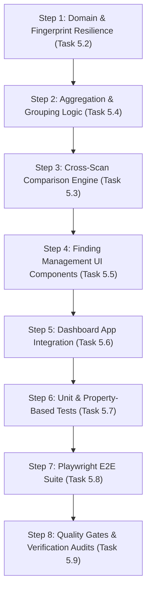

# Phase 5 Execution Plan

## Finding Intelligence, Aggregation & Cross-Scan Comparison

**Project:** Phantom Audit — Kiroween 2026 (Costume Contest)  
**Phase:** 5 of 12  
**Date:** 2026-11-06  
**Status:** READY FOR IMPLEMENTATION

---

## 1. Executive Summary & Architectural Scope

Phase 4 established the local `axe-core` 4.14.0 scanning engine, isolated-world execution, in-page sanitization, and basic room mapping.

**Phase 5** elevates the raw accessibility output into an **intelligent, resilient, and actionable finding analysis platform**:

1. **Canonical Fingerprint v1 Resilience:** Hardens selector normalization to resist insignificant DOM refactoring (class order variations, whitespace differences, attribute quotes) and deterministically sorts target arrays.
2. **Multi-Dimensional Aggregation:** Provides non-destructive grouping and statistics across four distinct axes:
   - Mansion Room (7 chambers)
   - Severity Impact (Critical, Serious, Moderate, Minor)
   - WCAG Principle (Perceivable, Operable, Understandable, Robust, Advisory Best Practice)
   - Review Status (Reviewed, Unreviewed)
3. **Cross-Scan Comparison Engine:** Implements a pure functional diffing algorithm that compares consecutive scans, identifying `resolved`, `unchanged`, `newFindings` (regressions), and **`uncertainMatches`** (preventing false "resolved" claims when selectors shift while the underlying violation persists).
4. **Finding Management UI:** Enhances the dashboard with high-performance text search, multi-severity filters, conformance vs. advisory toggles, grouped finding lists, and one-click selector copy actions.

---

## 2. File-by-File Implementation Plan

### 2.1 Domain & Schemas

- **`src/domain/finding.ts`:**
  - Add `WcagPrinciple` type (`perceivable`, `operable`, `understandable`, `robust`, `best-practice`).
  - Add `UncertainFindingMatch` interface.
- **`src/domain/report.ts`:**
  - Update `ScanComparison` to include `uncertainMatches: UncertainFindingMatch[]` and `metrics: ScanComparisonMetrics`.
- **`src/lib/validation/schemas.ts`:**
  - Export `WcagPrincipleSchema`, `UncertainFindingMatchSchema`, and `ScanComparisonSchema`.

### 2.2 Workstream 1: Fingerprint Resilience

- **`src/features/normalization/fingerprint.ts`:**
  - Enhance `normalizeSelector` to canonicalize:
    - Intra-element class lists alphabetically (e.g. `button.btn-primary.btn` -> `button.btn.btn-primary`).
    - Attribute selector quotes (e.g. `[data-role='btn']` -> `[data-role="btn"]`).
    - Combinator spacing (`>`, `+`, `~`).
    - Shadow DOM / iframe target tuples (`' >>> '`).
  - Strengthen `generateFindingFingerprint(ruleId, targets)`:
    - Normalizes and deduplicates all target selectors.
    - Alphabetically sorts target selectors using Unicode code-point collation.
    - Formats canonical fingerprint: `v1:{ruleId}:{sortedNormalizedTargets}`.
  - Provide `parseFingerprint` and `areFingerprintsEqual`.

### 2.3 Workstream 2: Finding Aggregation

- **`src/features/findings/finding-aggregation.ts` (NEW):**
  - Implement `groupByRoom(findings)`
  - Implement `groupBySeverity(findings)`
  - Implement `groupByPrinciple(findings)`
  - Implement `groupByReviewStatus(findings)`
  - Implement `computeFindingSummaryStats(findings)`
  - Map every axe-core rule to its primary WCAG principle (POUR).

### 2.4 Workstream 3: Cross-Scan Comparison

- **`src/features/comparison/scan-comparator.ts` (NEW):**
  - Implement `compareScans(baselineScan: ScanRecord, rescan: ScanRecord): ScanComparison`.
  - Exact fingerprint set-diffing for `unchanged`.
  - Heuristic similarity detection for `uncertainMatches` (matching ruleId + roomId + element tag name).
  - Calculate `resolved` (baseline findings with neither exact nor uncertain match).
  - Calculate `newFindings` (rescan findings with neither exact nor uncertain match).
  - Calculate `improvementScore` and net progress metrics.

### 2.5 Workstream 4: Finding Management UI

- **`src/features/findings/finding-filters.ts` (NEW):**
  - Filter and sort pipeline supporting text search, severity filter sets, room filters, advisory vs. conformance toggles, and review status.
- **`src/components/findings/FindingFilterBar.tsx` (NEW):**
  - Search input with clear button (`X`).
  - Severity filter pills with dual-encoded badges.
  - Conformance level tabs (`All`, `WCAG Conformance`, `Advisory Only`).
  - Grouping selector (`Flat List`, `By Room`, `By Severity`, `By Principle`).
  - Sort dropdown (`Severity (High to Low)`, `Rule ID (A to Z)`, `Node Count`).
  - Active filter count pill and "Clear Filters" button.
- **`src/components/findings/GroupedFindingList.tsx` (NEW):**
  - Renders findings grouped by room, severity, or principle with collapsible section headers and count badges.
- **`src/components/findings/FindingCard.tsx` (ENHANCE):**
  - Add quick "Copy Selector" button with instant feedback.
  - Display "Reviewed" checkmark badge when reviewed.
  - Display "Advisory Best Practice" badge when rule is not WCAG A/AA.
- **`src/components/findings/FindingInspector.tsx` (ENHANCE):**
  - Add copy selector buttons on individual node excerpts.
  - Add "Copy HTML Snippet" button.
  - Add "Mark as Reviewed" toggle button.
  - Display WCAG Principle banner (POUR) with thematic badge.
- **`src/entrypoints/dashboard/App.tsx` (INTEGRATE):**
  - Integrate `FindingFilterBar` into list view and room detail views.
  - Handle search and filter state transitions.
  - Handle review status toggles and persist updates to `storageService`.

### 2.6 Testing Strategy

- **`tests/unit/fingerprint-resilience.test.ts` (NEW):**
  - Fast-check property-based tests verifying determinism, target order invariance, and class order canonicalization.
- **`tests/unit/scan-comparator.test.ts` (NEW):**
  - Comprehensive unit tests: 100% resolution, partial resolution, regression detection, uncertain matches, empty scans.
  - Partition invariant tests: $|B| = |\text{resolved}| + |\text{unchanged}| + |\text{uncertain}|$.
- **`tests/unit/finding-aggregation.test.ts` (NEW):**
  - Grouping and summary metric tests across all dimensions.
- **`tests/unit/finding-filters.test.ts` (NEW):**
  - Search matching, severity filtering, sorting logic tests.
- **`tests/unit/components/finding-filter-bar.test.tsx` (NEW):**
  - Component tests for search input, filter pills, and sort dropdowns.
- **`tests/e2e/phase5-finding-identity.test.ts` (NEW):**
  - Playwright E2E tests verifying search, filtering, copying selectors, and review status toggling in the real dashboard.

---

## 3. Backward Compatibility & Migration Risk Assessment

| Potential Risk                        | Severity | Mitigation Strategy                                                                                                                                             |
| :------------------------------------ | :------- | :-------------------------------------------------------------------------------------------------------------------------------------------------------------- |
| **Existing Stored Scan Fingerprints** | Low      | Fingerprints retain `v1:` prefix format. Selectors canonicalized in Phase 4 remain valid; enhanced normalizer is backward-compatible with Phase 4 fingerprints. |
| **`ScanComparison` Schema Expansion** | Low      | New fields (`uncertainMatches`, `metrics`) are optional or have defaults in Zod schema to avoid breaking existing reports.                                      |
| **Non-Destructive Aggregation**       | Low      | Aggregation functions return grouped arrays of original `FindingRecord` references; underlying entities are never cloned or mutated.                            |
| **Clipboard API Permissions**         | Low      | Uses standard `navigator.clipboard.writeText()` triggered strictly by explicit user click gestures, ensuring compatibility without extra extension permissions. |

---

## 4. Execution Sequence

---

## 5. Exit Criteria & Readiness Gate

Phase 5 will be considered complete when:

1. Canonical fingerprints are resilient to whitespace, combinator spacing, and class order permutations.
2. Cross-scan comparison accurately flags uncertain matches when selectors shift on failing elements.
3. Finding search, filtering, and grouping operate seamlessly in the dashboard.
4. All quality commands (`typecheck`, `lint`, `format:check`, `test`, `test:e2e`, `build`, `validate`) exit with code `0`.
5. Deliverables (`PHASE_5_FINAL_REPORT.md` and `PHASE_5_FINAL_INDEPENDENT_VERIFICATION.md`) are documented.
