# Phantom Audit — Phase 6 Master Execution Plan

## Intelligent Remediation Guidance Engine & Context-Aware Triage

**Project:** Phantom Audit  
**Hackathon:** Kiroween 2026 — Costume Contest  
**Phase:** 6 of 12  
**Status:** Architecture & Planning Phase (Awaiting User Sign-off)  
**Previous Phase:** Phase 5 (Finding Intelligence, Aggregation & Comparison Engine — Approved & Verified)

---

## 1. Executive Mission & Strategic Intent

Phase 6 elevates Phantom Audit from an accessibility detection tool into an actionable, education-driven remediation engine.

While typical accessibility checkers overwhelm developers with cryptic error messages and abstract WCAG conformance numbers, Phantom Audit provides deterministic, context-aware remediation guidance:

1. **What is wrong:** Precise defect identification anchored to the element's DOM context.
2. **Why it matters:** Real human impact on assistive technology users (screen reader, keyboard-only, low vision, cognitive).
3. **How to fix it:** Native HTML semantics first, with concrete copyable HTML, React/JSX, and CSS snippets.
4. **How to verify it:** Step-by-step verification procedures (keyboard test, screen reader announcement, rescan diffing).
5. **Remediation Lifecycle Tracking:** Safe state transitions (`suggested` $\to$ `attempted` $\to$ `verified` / `unresolved`) tied to cross-scan comparison.

---

## 2. Architectural Principles & Defensive Boundaries

1. **Zero Automatic Page Mutation:** Phantom Audit will NEVER automatically modify or inject DOM changes into audited websites. Automated fixes frequently break client-side application state, event handlers, and styling.
2. **Deterministic Catalog First:** Remediation rules are governed by a curated, locally bundled catalog of best practices (Deque University, W3C WAI-ARIA Authoring Practices Guide 1.2, WCAG 2.2 Understanding docs).
3. **Native HTML over ARIA:** Adheres to the First Rule of ARIA: _"If you can use a native HTML element or attribute with the semantics and behavior you require already built in, then do so instead of re-purposing an element and adding ARIA."_
4. **Zero AI API Dependency:** Guidance is generated locally, instantaneously, and deterministically without external API tokens, network calls, or hallucinations.
5. **Context-Aware Synthesis:** Recommendations parse the sanitized HTML excerpt to tailor the snippet (e.g. extracting existing element tags, classes, and attributes) rather than providing generic boilerplates.
6. **No Code Execution:** All generated remediation examples are rendered strictly as plain text in syntax-highlighted code blocks with escaped HTML. `dangerouslySetInnerHTML` remains strictly forbidden.

---

## 3. Workstream Decomposition

```mermaid
flowchart TD
    subgraph W1["Workstream 1: Domain, Catalog & Guidance Engine"]
        T1["Remediation Models & Zod Validation<br/>(RemediationGuidance, StoredRecord, Schemas)"]
        T2["Curated 10-Rule Catalog<br/>(7 Normative WCAG + 3 Axe Best Practice)"]
        T3["Context-Aware Guidance Engine<br/>(Bounded DOMParser token extraction & safe fallback)"]
    end

    subgraph W2["Workstream 2: Persistence & Remediation Tracker"]
        L1["Remediation Storage Service<br/>(phantom_remediation_v1, LRU eviction, quota cap: 200)"]
        L2["Remediation State Machine<br/>(suggested, attempted, verified, unresolved)"]
        L3["Verification API Boundary<br/>(Controlled scan outcome ingestion for Workstream 4)"]
    end

    subgraph W3["Workstream 3: Remediation User Experience"]
        U1["CodeSnippetViewer Component<br/>(Multi-Syntax HTML/React/CSS with safe text rendering)"]
        U2["RemediationGuidancePanel Component<br/>(Human impact, problem, fixes, and verification steps)"]
        U3["RemediationStatusBadge Component<br/>(Visual pill indicator for status)"]
        U4["FindingInspector Integration<br/>(Embeds guidance panel into inspector drawer)"]
    end

    subgraph W4["Workstream 4: Rescan Verification Integration"]
        V1["Dashboard & App.tsx Orchestration<br/>(Cross-scan diffing -> remediation verification)"]
        V2["Lifecycle State Sync<br/>(Auto-verify resolved findings; revoke regressions to unresolved)"]
    end

    subgraph W5["Workstream 5: Independent Audit & Polish"]
        Q1["Unit, Integration & Property-Based Tests"]
        Q2["Playwright E2E Guidance Scenarios"]
        Q3["Strict Typecheck & Validation Pipeline"]
    end

    W1 --> W2
    W2 --> W3
    W3 --> W4
    W4 --> W5
```



---

## 4. File-Level Implementation Plan

### 4.1 New Source Files

| Target File                                               | Purpose & Responsibilities                                                                                                                 |
| --------------------------------------------------------- | ------------------------------------------------------------------------------------------------------------------------------------------ |
| `src/domain/remediation.ts`                               | Domain types: `RemediationStatus`, `CodeSnippet`, `VerificationStep`, `HumanImpact`, `RemediationGuidance`, `FindingRemediationRecord`.    |
| `src/features/remediation/remediation-catalog.ts`         | Curated, deterministic knowledge base for 10 high-frequency WCAG rules across all 6 core mansion chambers.                                 |
| `src/features/remediation/guidance-engine.ts`             | Context-aware guidance synthesizer; parses HTML excerpts to personalize code snippets and verification checklists.                         |
| `src/features/remediation/remediation-tracker.ts`         | Manages finding remediation lifecycle (`suggested` $\to$ `attempted` $\to$ `verified` / `unresolved`) and connects with `scan-comparator`. |
| `src/components/remediation/CodeSnippetViewer.tsx`        | Tabbed code viewer (HTML / React JSX / CSS) with syntax highlights, line numbers, and one-click copy button.                               |
| `src/components/remediation/RemediationGuidancePanel.tsx` | Full remediation guidance section within `FindingInspector`: problem, impact, fixes, verification, and status selector.                    |
| `src/components/remediation/RemediationStatusBadge.tsx`   | Visual pill indicator for remediation status (`Suggested`, `Attempted`, `Verified`, `Unresolved`).                                         |
| `src/components/remediation/index.ts`                     | Clean public exports for remediation components.                                                                                           |

### 4.2 Modified Existing Files

| Target File                                    | Scope of Planned Modifications                                                                                                                 |
| ---------------------------------------------- | ---------------------------------------------------------------------------------------------------------------------------------------------- |
| `src/domain/finding.ts`                        | Add optional `remediationStatus?: RemediationStatus` to `FindingRecord`.                                                                       |
| `src/domain/index.ts`                          | Re-export remediation domain types.                                                                                                            |
| `src/lib/validation/schemas.ts`                | Add `RemediationStatusSchema`, `CodeSnippetSchema`, `RemediationGuidanceSchema`, and update `FindingRecordSchema`.                             |
| `src/lib/storage/index.ts`                     | Add `getRemediationStates()`, `saveRemediationState()`, and `clearRemediationStates()` to `StorageService` using key `phantom_remediation_v1`. |
| `src/components/findings/FindingCard.tsx`      | Display `RemediationStatusBadge` alongside existing severity and review badges.                                                                |
| `src/components/findings/FindingInspector.tsx` | Replace static placeholder with `RemediationGuidancePanel` passing contextual finding data and status toggle handlers.                         |
| `src/entrypoints/dashboard/App.tsx`            | Wire remediation status updates to local storage; handle cross-scan verification transitions when rescanning.                                  |

---

## 5. Storage Schema & Backward Compatibility

### Storage Key: `phantom_remediation_v1`

Stored in `chrome.storage.local` (and fallback `localStorage` for test/web preview):

```typescript
export interface StoredRemediationRecord {
  findingFingerprint: string;
  status: 'suggested' | 'attempted' | 'verified' | 'unresolved';
  updatedAt: string; // ISO-8601
  notes?: string;
  attemptedAt?: string;
  verifiedAtScanId?: string;
}

export type RemediationStoragePayload = Record<string, StoredRemediationRecord>;
```

### Backward Compatibility Guarantee

1. Existing scans saved in `phantom_scan_history_v1` remain 100% valid.
2. `remediationStatus` on `FindingRecord` is optional (defaults to `'suggested'`).
3. If stored remediation records reference an obsolete or pruned scan, lookup returns default `'suggested'` without throwing.

---

## 6. Implementation Risk Matrix & Mitigations

| Risk                                 | Impact   | Likelihood | Mitigation Strategy                                                                                                                                   |
| ------------------------------------ | -------- | ---------- | ----------------------------------------------------------------------------------------------------------------------------------------------------- |
| **Invalid ARIA Suggestions**         | High     | Low        | Enforce strict rule: native HTML elements `<button>`, `<a>`, `<label>` are prioritized over ARIA attributes in all templates.                         |
| **Malformed HTML Excerpt Context**   | Medium   | Medium     | Defensive tokenizer extracts tag names and existing attributes; if excerpt parsing fails, falls back to canonical pristine examples.                  |
| **False Verification Claims**        | Critical | Low        | Remediation status `verified` CANNOT be manually forced by user or assumed by UI; it requires a rescan where Phase 5 comparator certifies resolution. |
| **Bundle Size Overhead**             | Medium   | Low        | Deterministic guidance templates use compact structured strings; total dictionary overhead < 45 kB (uncompressed).                                    |
| **XSS / HTML Injection in Snippets** | Critical | Zero       | All code snippets render through text-only `<code>` elements. Zero use of `dangerouslySetInnerHTML`.                                                  |

---

## 7. Quality Gate Execution Requirements

Phase 6 completion requires:

1. `pnpm typecheck` (0 errors)
2. `pnpm lint` (0 warnings, 0 errors)
3. `pnpm format:check` (100% compliant)
4. `pnpm test` (All existing 165 unit tests + new Phase 6 remediation tests pass)
5. `pnpm test:e2e` (All existing 23 E2E tests + new Phase 6 remediation UI scenarios pass)
6. `pnpm build` (Package size remains < 1.3 MB)
7. `pnpm validate` (Clean exit code 0)
