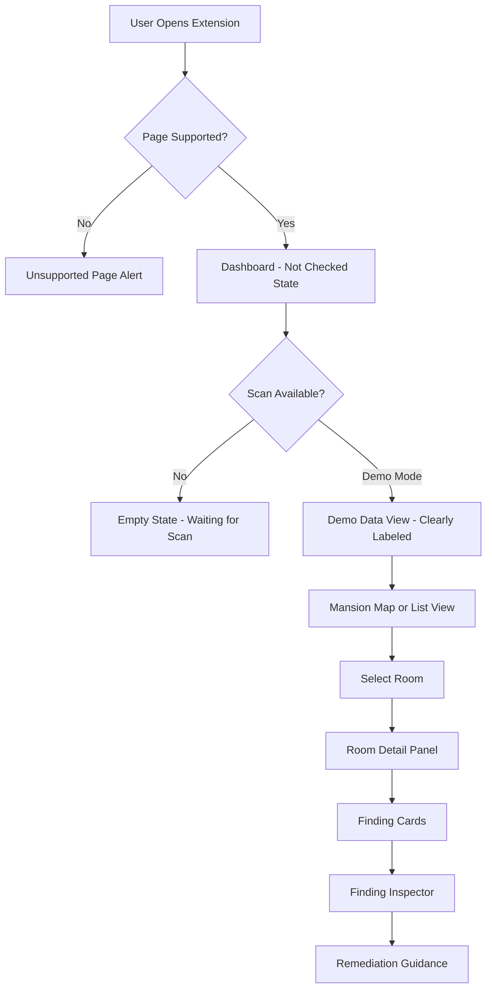

# Phase 2 — UX Architecture & Information Design

## 1. Information Hierarchy

```
Dashboard Shell
├── Skip Link (keyboard accessibility)
├── Application Header
│   ├── Branding (Phantom Audit logo + title)
│   ├── Target Page Context (URL, title, tab ID)
│   └── Controls Bar
│       ├── Reduced Motion Toggle
│       ├── View Mode Toggle (Mansion Map / List View)
│       └── Application State Indicator
├── Main Content Area
│   ├── State Banner (scan status / unsupported / demo mode)
│   ├── View Container
│   │   ├── Mansion Map View (SVG-based 2D mansion)
│   │   │   └── 7 Interactive Rooms (keyboard + pointer accessible)
│   │   └── List View (semantic HTML table)
│   │       └── 7 Room Rows with finding counts
│   ├── Room Detail Panel (selected room context)
│   │   ├── Room Metadata (name, theme, WCAG family)
│   │   ├── Finding Cards (severity-coded, expandable)
│   │   └── Finding Inspector (full detail view)
│   └── Application State Views
│       ├── Empty / No Scan History
│       ├── Demo Mode (mock data, clearly labeled)
│       ├── Loading
│       ├── Error
│       ├── No Findings (all quiet)
│       └── Findings Available
└── Compliance Footer
```

## 2. Screen Flow



## 3. Component Tree

| Component          | Location                                   | Purpose                                  |
| ------------------ | ------------------------------------------ | ---------------------------------------- |
| `App`              | `entrypoints/dashboard/App.tsx`            | Root shell, state management, routing    |
| `AppHeader`        | `components/layout/AppHeader.tsx`          | Branding, controls, preferences          |
| `TargetBanner`     | `components/layout/TargetBanner.tsx`       | Target page context display              |
| `MansionMap`       | `components/mansion/MansionMap.tsx`        | SVG 2D mansion visualization             |
| `MansionRoom`      | `components/mansion/MansionRoom.tsx`       | Individual SVG room element              |
| `RoomListView`     | `components/mansion/RoomListView.tsx`      | Accessible table alternative             |
| `RoomDetailPanel`  | `components/findings/RoomDetailPanel.tsx`  | Selected room detail sidebar             |
| `FindingCard`      | `components/findings/FindingCard.tsx`      | Individual finding summary card          |
| `FindingInspector` | `components/findings/FindingInspector.tsx` | Full finding detail panel                |
| `SeverityBadge`    | `components/shared/SeverityBadge.tsx`      | Impact level badge (color + text + icon) |
| `RoomStatusBadge`  | `components/shared/RoomStatusBadge.tsx`    | Room state indicator                     |
| `Button`           | `components/shared/Button.tsx`             | Reusable button variants                 |
| `Card`             | `components/shared/Card.tsx`               | Surface card container                   |
| `Badge`            | `components/shared/Badge.tsx`              | Generic badge/tag component              |
| `EmptyState`       | `components/states/EmptyState.tsx`         | Various empty state displays             |
| `DemoBanner`       | `components/states/DemoBanner.tsx`         | Mock data warning banner                 |

## 4. State Management

Application state managed via React useState hooks in App.tsx:

- `appState`: 'empty' | 'no-scan' | 'demo' | 'loading' | 'error' | 'unsupported' | 'no-findings' | 'findings'
- `viewMode`: 'mansion' | 'list'
- `selectedRoom`: RoomId | null
- `selectedFinding`: FindingRecord | null
- `preferences`: UserPreferences
- `mockFindings`: FindingRecord[] (Phase 2 demo data only)

## 5. Accessibility Requirements

- All interactive elements keyboard accessible
- Skip link to main content
- ARIA landmarks: banner, main, contentinfo
- Room SVG elements: role="button", aria-label with room name and state
- Severity communicated via color + text + icon (never color alone)
- prefers-reduced-motion respected at all levels
- Minimum 4.5:1 contrast for text, 3:1 for UI components
- Focus indicators visible (3px ring, high contrast)
- List view always available as mansion alternative
- Screen reader announcements for state changes

## 6. Mock Data Strategy

All Phase 2 mock data:

- Stored in `src/fixtures/mock-findings.ts`
- Clearly labeled with `[DEMO]` prefix in UI
- Contains representative findings across all severity levels
- Covers all 7 mansion rooms
- Never presented as real scan results
- Used only to demonstrate UI components
