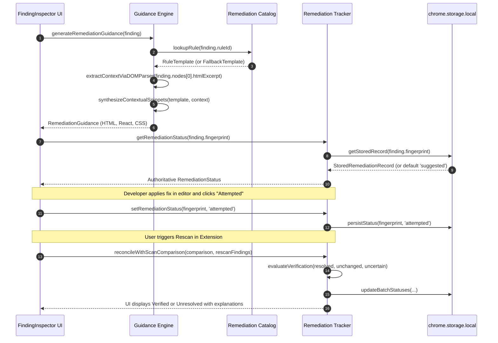
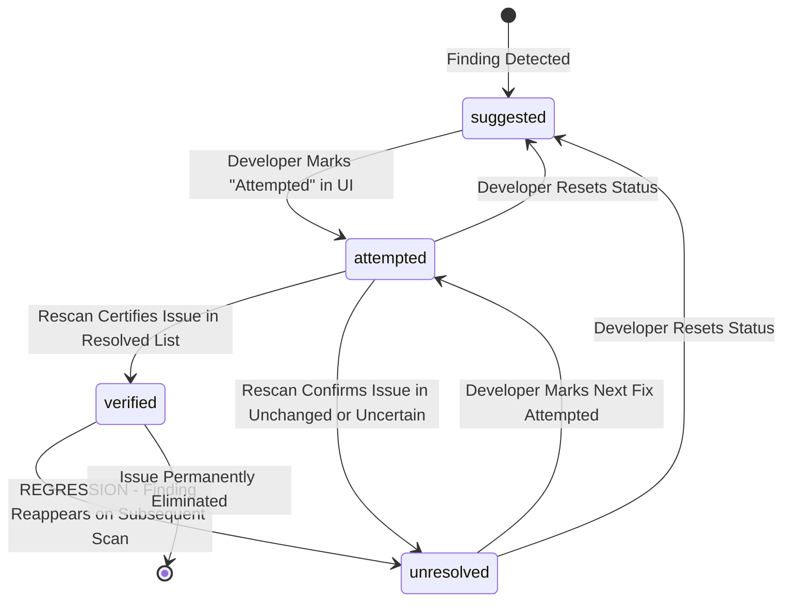

# Phantom Audit — Remediation Engine Architectural Specification

## Module: `src/features/remediation/`

**Document Version:** 1.1.0 (Audited & Corrected)  
**Status:** Architecture Blueprint (Phase 6 Planning)  
**Parent Document:** `docs/PHASE_6_EXECUTION_PLAN.md`  
**Reference Document:** `docs/audits/PHASE_6_ARCHITECTURE_REVIEW.md`

---

## 1. Module Overview & Responsibilities

The **Remediation Engine** transforms low-level automated findings into actionable, context-aware engineering corrections without modifying target websites, executing code, or relying on external AI APIs.

It executes through four modular stages:

1. **Bounded Context Extraction:** Safely extracts the element's tag name, attributes, and text using a detached `DOMParser` rather than fragile regex expressions.
2. **Deterministic Guidance Synthesis:** Correlates the finding against `REMEDIATION_CATALOG` to produce tailored HTML, React JSX, and CSS fixes. If the rule is unmapped, an honest fallback guidance object is synthesized from axe-core metadata.
3. **Authoritative State Tracking:** Tracks the remediation lifecycle (`suggested` $\to$ `attempted` $\to$ `verified` / `unresolved`) with `chrome.storage.local` key `phantom_remediation_v1` as the single source of truth.
4. **Cross-Scan Verification Reconciliation:** Integrates with Phase 5's `compareScans` to verify genuine resolutions and immediately revoke false verifications upon regression.



---

## 2. Bounded Context Extraction (Safe DOMParser)

### The Fragility of Regex Parsing

Previous architectures used regex matches against raw HTML strings. This is prone to edge cases:

- Tags with quotes inside attribute values (`<button data-tooltip="Click > here">`).
- Complex multi-line SVG structures.
- Unquoted attribute values (`<input type=text>`).

### The Bounded `DOMParser` Architecture

In Chromium MV3 extension pages (such as `dashboard.html`), the standard browser `DOMParser` is available natively:

- Parses detached HTML into a document fragment (`new DOMParser().parseFromString(sanitizedExcerpt, 'text/html')`).
- **Never executes scripts:** Detached DOMParser documents do not evaluate inline `<script>` tags or load external images/stylesheets.
- Safely inspects `doc.body.firstElementChild`:
  - `tagName = el.tagName.toLowerCase()`
  - `id = el.id || undefined`
  - `className = el.className || undefined`
  - `type = el.getAttribute('type') || undefined`
  - `placeholder = el.getAttribute('placeholder') || undefined`
  - `ariaLabel = el.getAttribute('aria-label') || undefined`
  - `textContent = el.textContent?.trim() || undefined`
- **Graceful Fallback:** If `htmlExcerpt` is missing, empty, or fails parsing, the engine immediately falls back to pristine canonical templates from the catalog.

---

## 3. Remediation Lifecycle & State Machine



### Strict State Transition Rules

1. **User Freedom to Attempt:** Developers may toggle status between `'suggested'` and `'attempted'` at any time.
2. **No Manual "Verified" Forcing:** The UI **prohibits** users from manually clicking a button to mark a finding `'verified'`.
3. **Verification via Rescan Only:** Only a subsequent scan that yields a valid `ScanComparison` where the finding fingerprint is present in `comparison.resolved` can transition status to `'verified'`.
4. **Anti-Fraud Invariant (Uncertain Matches):** Findings appearing in `comparison.uncertainMatches` (shifted selectors on identical element) are **NEVER** marked `'verified'`. If previously `'attempted'`, they transition to `'unresolved'` with the explanation: _"Selector shifted but element continues to fail."_
5. **Regression Revocation Invariant:** If a finding was previously marked `'verified'`, but on a future rescan the exact same fingerprint or rule reappears on that page, its status is **immediately revoked** to `'unresolved'`. A finding actively failing on the page can never retain a verified badge.
6. **Failed or Cancelled Rescans:** If a rescan fails (timeout, navigation error, ineligible page), existing remediation statuses remain unchanged.

---

## 4. Single Source of Truth & Storage Architecture

### Storage Key: `phantom_remediation_v1`

Stored directly in `chrome.storage.local` (with test harness fallback):

```typescript
export interface StoredRemediationRecord {
  fingerprint: string;
  status: 'suggested' | 'attempted' | 'verified' | 'unresolved';
  updatedAt: string; // ISO-8601
  attemptedAt?: string; // ISO-8601
  verifiedAtScanId?: string; // Scan ID where verified
  notes?: string; // User notes (strictly capped at 500 chars)
}

export type RemediationStoragePayload = Record<string, StoredRemediationRecord>;
```

### Storage Safety Invariants

1. **Zero Excerpt Duplication:** Code snippets and HTML excerpts are **NEVER** persisted in `phantom_remediation_v1`. The finding fingerprint binds the remediation record to the finding.
2. **Zero Sensitive Data:** Passwords, form values, and tokens are already stripped by `sanitizeExcerpt` during scanning and are excluded from remediation storage.
3. **Bound Limits:**
   - User notes are capped at 500 characters and stripped of HTML tags.
   - Storage map is capped at a maximum of 200 active remediation entries using LRU pruning.

---

## 5. Security & Safety Invariants

1. **Strictly Escaped Code Rendering:** All suggested code examples are rendered exclusively through text nodes in `<pre><code>`. Zero usage of `dangerouslySetInnerHTML`.
2. **Zero Auto-Mutation:** Phantom Audit never executes scripts or mutates target website DOM.
3. **No Dynamic Code Evaluation:** The extension bundle never calls `eval()` or `new Function()`.
4. **100% Offline Execution:** All rule templates and guidance logic are compiled locally into the bundle. Zero external API calls, zero telemetry.
