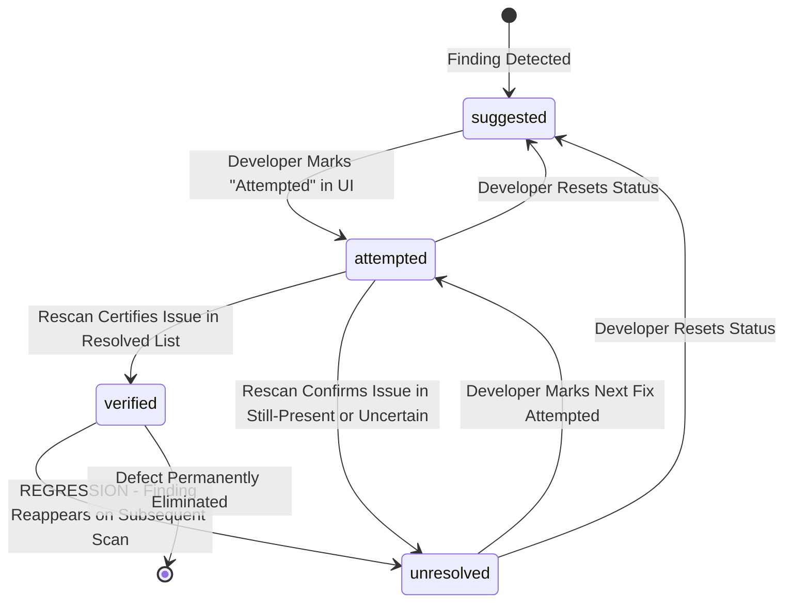

# Phantom Audit — Phase 6 Workstream 2 Implementation Report

**Project:** Phantom Audit  
**Hackathon:** Kiroween 2026 — Costume Contest  
**Phase:** 6 of 12 — Intelligent Remediation Guidance  
**Workstream:** 2 of 5 — Persistence & Remediation Tracker  
**Status:** COMPLETE & VERIFIED

---

## 1. Executive Summary

Workstream 2 delivers a robust, local persistence layer and a deterministic lifecycle state tracker for accessibility remediation. The engine enforces strict state integrity: findings cannot be manually declared "verified" without scan certification, uncertain selector changes never produce false resolutions, regressions immediately revoke verified badges to unresolved, and user notes/in-flight fixes are strictly protected against eviction.

All quality gates passed with zero warnings, zero errors, 312 passing unit tests across 29 test suites, and 23 passing Playwright end-to-end tests.

---

## 2. Files Created & Modified

| File                                                 | Status   | Description                                                                                                                                                                                                                                                                                          |
| ---------------------------------------------------- | -------- | ---------------------------------------------------------------------------------------------------------------------------------------------------------------------------------------------------------------------------------------------------------------------------------------------------- |
| `src/domain/remediation.ts`                          | Modified | Added domain types for `ScanVerificationOutcomeType`, `ScanVerificationResult`, and `VerificationTransitionResult`.                                                                                                                                                                                  |
| `src/lib/validation/schemas.ts`                      | Modified | Added runtime Zod validation schemas: `ScanVerificationOutcomeTypeSchema` and `ScanVerificationResultSchema`.                                                                                                                                                                                        |
| `src/lib/storage/index.ts`                           | Modified | Extended `StorageService` with `getRemediationRecords`, `getRemediationRecord`, `saveRemediationRecord`, `updateRemediationStatus`, and `clearRemediationData`. Implemented `pruneRemediationRecords` with `RemediationQuotaExceededError`. Updated `clearAllData` to wipe `phantom_remediation_v1`. |
| `src/features/remediation/remediation-tracker.ts`    | Created  | Deterministic remediation tracker and state machine implementing user actions, prohibited transitions, pure transition evaluation (`evaluateVerificationTransition`), and controlled batch verification API.                                                                                         |
| `src/features/remediation/index.ts`                  | Modified | Exported `RemediationTracker`, `remediationTracker`, `InvalidStateTransitionError`, `InvalidFingerprintError`, and `evaluateVerificationTransition`.                                                                                                                                                 |
| `tests/unit/remediation/remediation-storage.test.ts` | Created  | 13 unit tests covering CRUD, timestamps, notes length ceiling, data isolation from scan history, corrupt storage recovery, and deterministic eviction.                                                                                                                                               |
| `tests/unit/remediation/remediation-tracker.test.ts` | Created  | 19 unit tests covering default status, user transitions, manual verification prohibition, pure verification evaluation, regression detection, and batch processing.                                                                                                                                  |
| `tests/unit/remediation/remediation-domain.test.ts`  | Modified | Added 3 tests validating `ScanVerificationOutcomeTypeSchema` and `ScanVerificationResultSchema` (total: 17 tests).                                                                                                                                                                                   |
| `tests/unit/storage.test.ts`                         | Modified | Added test confirming `clearAllData()` clears preferences, scan history, and remediation data in tandem.                                                                                                                                                                                             |
| `docs/PHASE_6_EXECUTION_PLAN.md`                     | Modified | Updated mermaid architecture diagram to align with the approved 5-workstream sequence.                                                                                                                                                                                                               |

---

## 3. Storage Architecture (`phantom_remediation_v1`)

Remediation tracking is decoupled from raw scan records:

1. **Storage Key:** Stored under `phantom_remediation_v1` in `chrome.storage.local` (with `localStorage` fallback in non-extension environments).
2. **Zero Excerpt Duplication:** Code snippets and HTML excerpts are never stored in the remediation payload. The stable `fingerprint` acts as the relational foreign key binding remediation state to scan findings.
3. **Data Isolation:** `clearRemediationData()` clears only remediation states while preserving scan history (`phantom_scan_history_v1`) and user preferences (`phantom_user_preferences_v1`).
4. **Defensive Ingestion:** Any corrupted or unparseable record in storage is skipped safely during deserialization without crashing the application.

---

## 4. Deterministic Eviction Policy (200-Record Ceiling)

To prevent unbounded local storage growth, a deterministic 200-record limit is enforced via `pruneRemediationRecords()`:

- **Record Capacity:** Maximum 200 records (`MAX_REMEDIATION_RECORDS = 200`).
- **Candidate Pool 1 (First Evicted):** Oldest `verified` records, sorted chronologically by `updatedAt` ascending.
- **Candidate Pool 2 (Second Evicted):** Oldest `suggested` records that possess **no user notes** (`!notes || notes.trim() === ''`).
- **Strictly Non-Evictable:**
  - Active `unresolved` records (open defects and detected regressions).
  - Active `attempted` records (developer fixes in progress).
  - Records containing user notes (developer documentation is preserved).
- **Quota Exceeded Guard:** If capacity reaches 200 and all entries are non-evictable, the system throws `RemediationQuotaExceededError` rather than silently losing user progress.

---

## 5. Remediation Lifecycle & State Machine



### Strict State Transition Rules

1. **Default Status:** Untracked findings default to `'suggested'`.
2. **User Discretion:** Developers can toggle findings between `'suggested'` and `'attempted'`.
3. **Prohibited Manual Verification:** Users cannot manually mark a finding `'verified'`. Invoking `manuallySetVerified()` throws `InvalidStateTransitionError`.
4. **Anti-Fraud (Uncertain Matches):** Uncertain matches (`uncertain-match`) where a selector shifted but the underlying element defect persists **never** produce `'verified'`. If previously `'attempted'`, they transition to `'unresolved'`.
5. **Regression Revocation:** If a finding was `'verified'` in an earlier scan, but is detected again (`still-present`), its status is **immediately revoked** to `'unresolved'` with an explicit regression notification.
6. **Inconclusive Scan Safeguard:** Scans resulting in `'failed-scan'`, `'cancelled-scan'`, `'incomplete-scan'`, or `'incomparable-scan'` leave remediation states untouched (`action: 'retained'`).

---

## 6. Controlled Verification API Boundary (For Workstream 4)

The tracker provides an internal API boundary designed for Workstream 4 rescan diffing:

```typescript
export interface ScanVerificationResult {
  fingerprint: string;
  outcome: ScanVerificationOutcomeType;
  scanId?: string;
  reason?: string;
}

export interface VerificationTransitionResult {
  fingerprint: string;
  previousStatus: RemediationStatus;
  newStatus: RemediationStatus;
  action: 'verified' | 'unresolved' | 'retained' | 'suggested';
  reason: string;
  updatedRecord?: StoredRemediationRecord;
}
```

The method `remediationTracker.applyBatchVerification(outcomes)` allows the future scan orchestrator in `App.tsx` to pass cross-scan diff outcomes in a single call.

---

## 7. Quality Gate Verification

| Quality Gate               | Command             | Exit Code | Result                                                     |
| -------------------------- | ------------------- | :-------: | ---------------------------------------------------------- |
| TypeScript Compilation     | `pnpm typecheck`    |    `0`    | Zero type errors                                           |
| ESLint Linting             | `pnpm lint`         |    `0`    | Zero errors, zero warnings                                 |
| Prettier Code Style        | `pnpm format:check` |    `0`    | All files conform to Prettier                              |
| Vitest Unit Tests          | `pnpm test`         |    `0`    | **29 test files, 312 tests passed** (49 new/updated tests) |
| Playwright E2E Tests       | `pnpm test:e2e`     |    `0`    | **23 browser tests passed**                                |
| Extension Build            | `pnpm build`        |    `0`    | Extension bundle built (1.22 MB package)                   |
| Master Validation Pipeline | `pnpm validate`     |    `0`    | Full typecheck + lint + test + build pipeline passed       |

---

## 8. Clarification of Planning Sequence

In early drafts of `docs/PHASE_6_EXECUTION_PLAN.md`, workstreams were numbered with UI at Workstream 4. The plan has been aligned with the approved master sequence:

1. **Workstream 1:** Domain, Remediation Catalog & Guidance Engine _(Complete)_
2. **Workstream 2:** Persistence & Remediation Tracker _(Complete)_
3. **Workstream 3:** Interactive Code Remediation UI Components & Snippet Copy _(Next)_
4. **Workstream 4:** Cross-Scan Verification Lifecycle & Dashboard Integration
5. **Workstream 5:** Independent Audit & Production Polish

---

## 9. Strict Scope Boundary Invariant

As required by the Workstream 2 specification:

- **NOT IMPLEMENTED IN WORKSTREAM 2:**
  - React remediation UI components (`CodeSnippetViewer`, `RemediationGuidancePanel`, `RemediationStatusBadge`).
  - `FindingInspector` drawer modifications.
  - Interactive status toggle buttons in the dashboard.
  - Dashboard rescan orchestration in `App.tsx`.

These belong to **Workstream 3** and **Workstream 4**.

---

## 10. Stop Condition & Next Step

Workstream 2 is complete, tested, and verified.

**Next Step:** Proceed to **Workstream 3: Interactive Code Remediation UI Components & Snippet Copy** upon user authorization.
