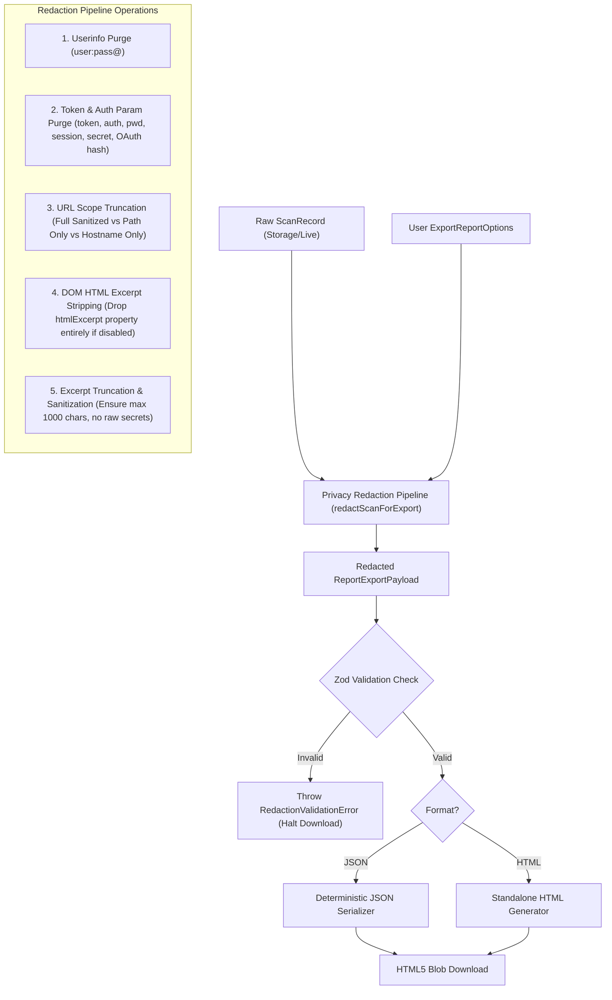
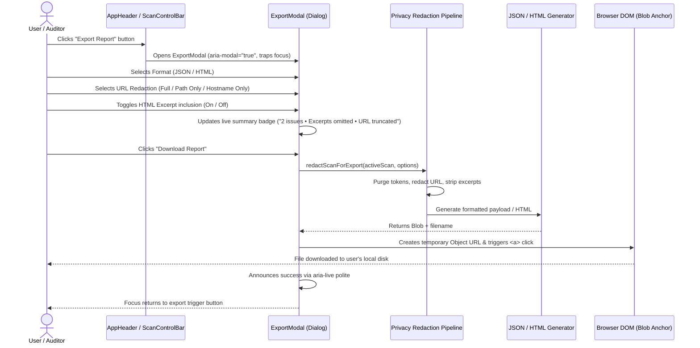

# Phantom Audit — Phase 8 Architecture Review

## Reporting & Privacy Export Architecture

**Document Version:** 1.0.0  
**Phase:** Phase 8 of 12 — Reporting & Privacy Export  
**Review Status:** ARCHITECTURE COMPLETE — AWAITING IMPLEMENTATION APPROVAL  
**Source of Truth:** `04_phantom_audit_project_spec_kiroween_2026.md`, `docs/PHASE_ROADMAP.md`

---

## 1. Executive Summary & Root Specification Traceability

Phase 8 builds the **Reporting & Privacy Export** subsystem for **Phantom Audit**, enabling auditors, developers, and QA engineers to capture, export, and share accessibility audit findings locally and safely without compromising user privacy or leaking sensitive DOM data.

### 1.1 Specification Traceability Matrix

| Requirement ID | Specification Requirement                                                                         | Priority | Architectural Solution                                                                                                                                                                                                                                                                                                   |
| :------------- | :------------------------------------------------------------------------------------------------ | :------: | :----------------------------------------------------------------------------------------------------------------------------------------------------------------------------------------------------------------------------------------------------------------------------------------------------------------------- |
| **FR-060**     | **Export JSON report**: Exported JSON validates against published report schema                   |  **P0**  | Strongly typed, versioned `ReportExportPayload` schema validated via Zod (`ReportExportPayloadSchema`), guaranteeing deterministic, reproducible serialization with ISO-8601 timestamps, stable finding sort order, and explicit testing limitations.                                                                    |
| **FR-061**     | **Export readable HTML report**: Includes metadata, findings, limitations, references             |  **P1**  | Fully self-contained, offline-first HTML document with inline CSS based on the Haunted Victorian Mansion design tokens. Zero remote scripts, fonts, images, or CDNs. Features responsive layout, semantic headings, tables, remediation snippets, manual review checklist, and `@media print` formatting.                |
| **FR-062**     | **Redact report details**: User can omit HTML excerpts and optionally omit full URL/query strings |  **P0**  | Centralized, pure-functional privacy pipeline (`redactScanForExport`) executing _prior_ to serialization and rendering. Mandatory stripping of credentials and sensitive tokens. Support for URL scope toggling (Full Sanitized, Path Only, Hostname Only) and DOM excerpt omission. Verified via byte-inspection tests. |
| **NFR-007**    | **Security & Privacy**: Minimal permissions, no remote code, sanitized exports                    |  **P0**  | Extension utilizes standard HTML5 Blob Object URL downloads via temporary anchor element. **Zero additional browser permissions** required (no Chrome `downloads` permission). Complete client-side generation without telemetry or external APIs.                                                                       |
| **Section 11** | **Accessibility limitations & non-compliance claim notice**                                       |  **P0**  | Prominent disclaimer embedded in both JSON and HTML exports stating automated testing only covers a subset of WCAG criteria and that zero violations does not certify WCAG conformance.                                                                                                                                  |
| **Section 12** | **`EXPORT_REPORT` internal contract**                                                             |  **P0**  | Validated internal message/service interface: `(scanId: string, options: ExportReportOptions) => Promise<{ filename: string; blob: Blob; mimeType: string }>`.                                                                                                                                                           |

---

## 2. Current Architecture Findings & Codebase Analysis

### 2.1 Existing Foundations in Repository

1. **Foundational Types in `src/domain/report.ts`:**
   - Already defines `ExportReportOptions` (`includeHtmlExcerpts`, `redactUrlQueryParameters`, `format: 'json' | 'html'`).
   - Already defines `ReportExportPayload` (`version: '1.0.0'`, `exportedAt`, `scan: ScanRecord`, `options`, `disclaimer`).
   - _Enhancement needed:_ Expand `ExportReportOptions` to support explicit URL scope (`'full' | 'path-only' | 'hostname-only'`), and enrich `ReportExportPayload` with generator metadata, aggregated severity counts, and optional remediation catalog guidance.

2. **Storage and Sanitization Subsystem (`src/lib/storage/index.ts`):**
   - Implements `sanitizeUrlForStorage(urlStr: string): string` with guaranteed idempotency and thorough credential/token removal (userinfo, sensitive query params like `token`, `auth`, `password`, `api_key`, `secret`, and OAuth hash tokens).
   - _Design Decision:_ The export privacy pipeline will leverage and extend this logic to guarantee that credentials and session tokens can never leak into an exported file, even if the user requests "Full URL".

3. **Runtime Schema Validation (`src/lib/validation/schemas.ts`):**
   - Contains strict Zod schemas for `ScanRecord`, `FindingRecord`, `FindingNode`, `Impact`, `RoomId`, and `ScanComparison`.
   - Currently lacks schemas for report export.
   - _Design Decision:_ Add `ExportReportOptionsSchema` and `ReportExportPayloadSchema` (validating schemaVersion `1.0.0`). Every export must pass Zod validation _before_ serialization or file download.

4. **Remediation Catalog & Guidance Engine (`src/features/remediation/`):**
   - Contains the 10-rule static remediation catalog (`remediation-catalog.ts`) and contextual code snippet generator (`guidance-engine.ts`).
   - _Design Decision:_ The report generator will cross-reference finding rule IDs against the local remediation catalog to embed recommended remediation snippets and WCAG references directly into the exported reports without dynamic fetches.

5. **Extension Manifest & Download Permissions (`wxt.config.ts`):**
   - Current permissions: `['activeTab', 'scripting', 'storage']`.
   - **Critical Investigation:** Can Blob downloads be performed without the Chrome `downloads` permission?
     - **Finding:** Yes. The extension dashboard runs as an extension tab (`chrome-extension://.../dashboard.html`). In extension dashboard pages, standard DOM download APIs (`URL.createObjectURL(blob)`, creating an `<a download="...">` element, programmatically clicking it, and revoking the object URL) work synchronously and natively without requiring `chrome.downloads` permission.
     - **Security Principle:** We strictly avoid adding the `downloads` permission to `wxt.config.ts`. The extension maintains its minimal least-privilege permission set.

---

## 3. Comparison Report Scope Investigation

The root specification was audited regarding exporting cross-scan comparison results:

- **Specification Evidence:**
  - Section 2 ("User personas & user stories"): Mentions a QA engineer goal: _"Local scan history and comparison reports."_
  - Section 4.7 ("Reporting and local history"):
    - `FR-060`: _"Export JSON report: Exported JSON validates against the published report schema."_
    - `FR-061`: _"Export readable HTML report: Report includes metadata, findings, limitations and references."_
    - `FR-062`: _"Redact report details: User can omit HTML excerpts and optionally omit full URL/query string before export."_
  - Section 12 ("API and internal message contracts"):
    - `EXPORT_REPORT`: Dashboard → report service | `scan ID, format, redaction options` | `Blob/download payload`. (Notice singular `scan ID`).
  - Appendix A ("End-to-end user journeys"): Step 9–10: _"The user exports a report with optional HTML excerpt redaction. The report includes the scan timestamp, page URL/host according to redaction selection, axe-core version, findings, incomplete checks and the automated-testing limitation notice."_

### 3.1 Scope Decision

1. **Normative Scope for Phase 8:**
   - Single-scan export (both JSON and HTML) for completed live scans and historical scan snapshots is the **mandatory requirement** (FR-060, FR-061, FR-062).
   - If an exported scan contains Phase 6 remediation verification annotations or Phase 7 comparison metadata (e.g. `comparisonCategory: 'verified-fix'`), those annotations are included within the finding records.
2. **Explicit Out-of-Scope for Phase 8 Release Gate:**
   - A standalone, dual-scan diff export format (e.g., comparing two distinct scan snapshots in a specialized diff-only JSON schema or dual-column diff HTML) is **NOT** required by FR-060/FR-061/FR-062.
   - Adding a separate comparison diff export schema would risk scope creep and delay Phase 8 release.
   - **Recommendation:** Document dual-scan diff export as a planned future enhancement for Phase 11 (Polish & Differentiation). Phase 8 will focus purely on bulletproof single-scan JSON and HTML generation with privacy controls.

---

## 4. Report Domain & Schema Architecture

### 4.1 Versioned Data Contract

The JSON report schema will be strictly versioned as `1.0.0` (`schemaVersion: 1`). Any future schema evolutions will increment the version number, with backward-compatibility transformers.

```typescript
export type UrlRedactionLevel = 'full' | 'path-only' | 'hostname-only';

export interface ExportReportOptions {
  format: 'json' | 'html';
  includeHtmlExcerpts: boolean;
  urlRedactionLevel: UrlRedactionLevel;
  includeRemediationGuidance: boolean;
}

export interface ReportMetadata {
  reportId: string; // Conforming UUID v4
  generator: 'Phantom Audit';
  version: '1.0.0';
  schemaVersion: 1;
  exportedAt: string; // ISO-8601 UTC timestamp
  environment: {
    extensionVersion: string;
    axeVersion: string;
    browserName: 'chrome' | 'edge' | 'unknown';
  };
  optionsApplied: ExportReportOptions;
}

export interface ReportTarget {
  url: string; // Sanitized or redacted based on urlRedactionLevel
  hostname: string;
  pageTitle: string;
  scannedAt: string;
  completedAt?: string;
  scanId: string;
}

export interface ReportSummary {
  totalFindings: number;
  criticalCount: number;
  seriousCount: number;
  moderateCount: number;
  minorCount: number;
  passesCount: number;
  incompleteChecksCount: number;
  inapplicableCount: number;
  roomsSummary: Record<
    RoomId,
    {
      totalFindings: number;
      criticalCount: number;
      seriousCount: number;
      moderateCount: number;
      minorCount: number;
    }
  >;
}

export interface ExportedFindingNode {
  target: string[];
  htmlExcerpt?: string; // Omitted completely if includeHtmlExcerpts === false
  failureSummary: string;
}

export interface ExportedFinding {
  fingerprint: string;
  ruleId: string;
  impact: Impact;
  roomId: RoomId;
  roomName: string; // Human-readable mansion room title
  description: string;
  help: string;
  helpUrl?: string;
  wcagTags: string[];
  affectedNodeCount: number;
  nodes: ExportedFindingNode[];
  reviewed: boolean;
  comparisonCategory?: ComparisonCategory;
  remediationRecommendation?: {
    summary: string;
    suggestedSnippet?: string;
    verificationMethod?: string;
  };
}

export interface ReportExportPayload {
  reportMetadata: ReportMetadata;
  target: ReportTarget;
  summary: ReportSummary;
  findings: ExportedFinding[];
  manualReviewReminders: string[];
  disclaimer: string;
}
```

### 4.2 Mandatory Disclaimers and Limitations

Per Section 11 of the root spec, both JSON and HTML reports must contain the explicit automated testing limitations disclaimer:

> **Automated Accessibility Testing Limitations Notice:**  
> "This report was generated by Phantom Audit using automated axe-core rules. Automated accessibility testing tools can identify approximately 30% to 50% of potential accessibility barriers, but cannot determine complete WCAG conformance. Zero reported violations does NOT establish WCAG 2.2 conformance. Comprehensive accessibility requires human evaluation, including keyboard navigation, screen-reader verification, cognitive clarity, dynamic interaction inspection, and reflow/zoom testing."

Additionally, 8 standardized manual review prompts from Section 11.2 will be included:

1. Keyboard accessibility (all interactive controls operable without a mouse).
2. Logical focus order and visible focus indicators.
3. Modal dialog and popup focus containment.
4. Clear instructions and error notification handling.
5. Screen-reader announcements for dynamic DOM mutations.
6. Alternative media (captions, audio descriptions, transcripts).
7. 400% zoom and responsive reflow without horizontal scrolling or content loss.
8. Color independence (information not conveyed through color alone).

---

## 5. Privacy Redaction Pipeline Design

### 5.1 Pre-Serialization Redaction Guarantee

A core security invariant of Phantom Audit is: **Redaction occurs at the data model level before any serialization or rendering.**



### 5.2 Redaction Levels & Rules

1. **Mandatory Credential & Token Purge (Non-negotiable):**
   - Strips userinfo credentials (`username:password@`).
   - Strips sensitive query keys using regex matching (`token`, `auth`, `api_key`, `secret`, `password`, `session`, `signature`, `bearer`, `jwt`).
   - Strips sensitive OAuth hash fragments (`#access_token=...`).
   - _Applied regardless of user selection._
2. **URL Redaction Levels (`urlRedactionLevel`):**
   - `'full'`: Preserves the sanitized protocol, host, path, and non-sensitive query params (e.g. `https://haunted-manor.example.com/ballroom?page=1`).
   - `'path-only'`: Drops query string and hash completely, preserving only protocol, host, and path (e.g. `https://haunted-manor.example.com/ballroom`).
   - `'hostname-only'`: Drops path, query, and hash, preserving only origin/hostname (e.g. `https://haunted-manor.example.com`).
3. **HTML Excerpt Control (`includeHtmlExcerpts`):**
   - `false` (Recommended / Privacy-safe default): Every node's `htmlExcerpt` is completely omitted from the resulting payload. No excerpt strings exist in JSON keys or HTML markup.
   - `true`: Excerpts are retained, truncated to a safe 1000-character ceiling, and sanitized against scripts.

---

## 6. Standalone HTML Report Generation Architecture

### 6.1 Design Principles for HTML Reports

1. **Self-Contained & Completely Offline:**
   - **Zero external network requests:** No `@import url(...)` or `<link>` pointing to Google Fonts, CDNs, or external stylesheets.
   - All styling is embedded inside a single `<style>` block.
   - System font stacks (`system-ui, -apple-system, BlinkMacSystemFont, 'Segoe UI', Roboto, sans-serif` for body; `'Cinzel', 'Georgia', serif` with fallback for Gothic headings; `ui-monospace, 'Cascadia Code', monospace` for code/selectors).
   - Icons are rendered as lightweight, inline SVG elements (no icon fonts or external sprite sheets).
2. **XSS Immunity & Safe String Escaping:**
   - Pure functional string generator: `generateHtmlReport(payload: ReportExportPayload): string`.
   - Every untrusted string (`pageTitle`, `tabUrl`, `selector`, `failureSummary`, `description`, `help`, `htmlExcerpt`, `notes`) is escaped using an entity encoder (`&` -> `&amp;`, `<` -> `&lt;`, `>` -> `&gt;`, `"` -> `&quot;`, `'` -> `&#39;`).
   - Code snippets and HTML excerpts are rendered strictly inside `<pre><code>` blocks as escaped text entities, never as live markup.
   - Zero script tags in the generated report (`<script>` is strictly prohibited).
3. **Haunted Victorian Mansion Theme Fidelity:**
   - Dark theme matching Phantom Audit's aesthetic: `#0a0612` deep void background, `#140d21` elevated surfaces, `#a855f7` spectral purple accents, `#06b6d4` cyan, `#10b981` emerald, `#f59e0b` amber, and `#f43f5e` crimson.
   - Clear visual hierarchy with Mansion Room classification cards.
4. **Print & PDF Optimization (`@media print`):**
   - High-contrast light theme when printing: white background, black body text, crisp borders.
   - Page-break controls: `break-inside: avoid` on finding cards and summary boxes to prevent awkward pagination splits.
   - Hides interactive or decorative elements in print mode.
5. **Accessibility Standard for Generated Reports:**
   - WCAG 2.2 AA compliant typography, contrast ratios (> 4.5:1 text, > 3:1 graphical elements).
   - Semantic landmarks: `<header>`, `<main>`, `<section>`, `<aside>`, `<footer>`.
   - Accessible tables for summary breakdowns with `<th scope="col">` and `<th scope="row">`.
   - Skip link to main findings.

---

## 7. Export UI & Interaction Architecture

### 7.1 User Interaction Flow



### 7.2 UI Components & Layout

1. **Trigger Button:**
   - Positioned in `AppHeader.tsx` (and conditionally in `ScanHistoryDrawer.tsx` snapshot cards).
   - Labeled: `Export Report` with `Download` icon from `lucide-react`.
   - Accessible tooltip and `aria-haspopup="dialog"`.
2. **Export Modal (`ExportModal.tsx`):**
   - Semantic `<div role="dialog" aria-modal="true" aria-labelledby="export-dialog-title">`.
   - Focus trapped on open, restored to trigger on close; Escape key dismisses.
   - **Format Choice:** Radio cards for `JSON (Machine-Readable)` and `HTML (Standalone Document)`.
   - **URL Scope Selector:** Radio cards with live preview of the resulting target URL.
   - **Excerpt Redaction Toggle:** Checkbox with a subtle amber advisory notice: _"HTML excerpts may contain sensitive DOM text or user inputs. Disabling excerpts is recommended when sharing reports externally."_
   - **Live Preview Summary:** Informs the auditor of exactly what data will be exported before confirming.
   - **Action Buttons:** "Cancel" and "Download [Format] Report".

---

## 8. Security & Threat Modeling

| Threat Category                           | Potential Attack Vector                                                                                                       | Architectural Mitigation                                                                                                                                                                    |
| :---------------------------------------- | :---------------------------------------------------------------------------------------------------------------------------- | :------------------------------------------------------------------------------------------------------------------------------------------------------------------------------------------ |
| **XSS via Report Excerpts**               | Malicious page contains `<script>alert(1)</script>` in DOM excerpt; exported HTML executes payload when viewed.               | **Mitigation:** Zero unescaped string injection. Pure string builder uses strict entity encoding for all DOM strings. Zero `<script>` tags in generated HTML. No `dangerouslySetInnerHTML`. |
| **Credential / Token Leakage**            | Target page URL contains sensitive session token (`?token=secret123`), leaking authentication credentials into exported file. | **Mitigation:** Pre-serialization URL sanitization strips all known sensitive query parameters and credentials regardless of export options. Byte-level integration tests assert absence.   |
| **Form Data / PII Leakage**               | Scanned form fields contain user-entered passwords, card numbers, or PII.                                                     | **Mitigation:** In-page scanner only extracts structural tag attributes for allowlisted rules; default export configuration omits HTML excerpts completely.                                 |
| **Cross-Origin / Remote Injection**       | External CSS or fonts compromise offline privacy or log user IP addresses when report is opened.                              | **Mitigation:** Strict 100% offline requirement. No external URLs or CDN imports. Self-contained CSS and SVG icons.                                                                         |
| **Permission Escalation**                 | Adding `chrome.downloads` permission exposes user's entire download history to extension.                                     | **Mitigation:** Do NOT request `downloads` permission. Standard HTML5 Blob Object URL triggered within dashboard document context operates without special permissions.                     |
| **Denial of Service / Memory Exhaustion** | Exporting a massive 10,000-finding scan causes tab crash or frozen UI.                                                        | **Mitigation:** Streamlined object structures, lightweight string generation, and efficient Blob creation. Async generation prevents main thread locking.                                   |

---

## 9. Risks, Mitigations & Known Limitations

1. **Risk: Malformed or Incomplete Legacy Scans in History**
   - _Mitigation:_ Zod schema validation defends with safe fallback defaults for missing optional properties (e.g. `completedAt`, `helpUrl`, `remediationRecommendation`).
2. **Risk: International & Unicode Text Encoding in JSON/HTML**
   - _Mitigation:_ JSON serialized with UTF-8 encoding; HTML specifies `<meta charset="utf-8">`. Entities encode characters safely without corrupting international scripts.
3. **Risk: File Naming Collisions or Invalid Characters**
   - _Mitigation:_ Deterministic filename sanitizer: `phantom-audit-${hostname}-${date}-${format}.${ext}` with all non-alphanumeric characters replaced by hyphens.
4. **Known Limitation:**
   - Standalone HTML reports do not support dynamic interactive JavaScript (sorting, filtering in the HTML document) to strictly adhere to the no-executable-script security requirement. All sorting and filtering is baked into the generated layout.

---

## 10. Conclusion & Architectural Readiness

The reporting and privacy export architecture satisfies all constraints of the root specification, respects least-privilege permissions, prevents sensitive data leakage, and provides a polished, accessible experience consistent with the Haunted Victorian Mansion theme.

**Verdict: READY FOR EXECUTION PLANNING.**
