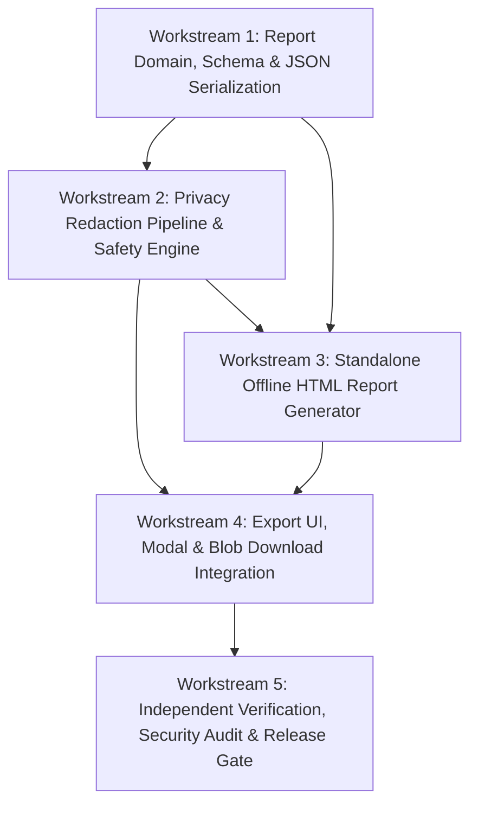

# Phantom Audit — Phase 8 Execution Plan

## Reporting & Privacy Export

**Document Version:** 1.0.0  
**Phase:** Phase 8 of 12 — Reporting & Privacy Export  
**Execution Status:** PROPOSED — PENDING ARCHITECTURE REVIEW APPROVAL  
**Source of Truth:** `04_phantom_audit_project_spec_kiroween_2026.md`, `docs/PHASE_ROADMAP.md`, `docs/phase-8/PHASE_8_ARCHITECTURE_REVIEW.md`

---

## 1. Overview & Scope Boundaries

Phase 8 implements the complete client-side reporting and privacy export subsystem for Phantom Audit. It enables auditors to export completed scans into:

1. **Machine-readable JSON** conforming to versioned schema `1.0.0` (FR-060).
2. **Human-readable, standalone HTML** styled in the Haunted Victorian Mansion aesthetic, 100% offline-ready, print-optimized, and fully accessible (FR-061).
3. **Auditor-controlled privacy redaction** allowing granular omission of HTML excerpts, query parameters, or entire URL paths, backed by mandatory token/credential stripping (FR-062).

### Strict Boundary Commitments:

- **Zero Production Code in this Plan:** No implementation until this plan is formally approved.
- **Zero Remote APIs or Network Requests:** All report generation occurs client-side.
- **Zero Added Browser Permissions:** Uses standard DOM Blob download APIs; **no** Chrome `downloads` permission.
- **No Scope Creep:** Cross-scan comparison diff exports are documented as future enhancements (Phase 11) and are explicitly out-of-scope for Phase 8 release.

---

## 2. Workstream Dependency Graph

---

## 3. Detailed Workstream Specifications

### Workstream 1: Report Domain, Versioned Schema & Deterministic JSON Serialization

#### 1. Scope & Objective

Establish the strongly typed report domain models, published Zod runtime schemas (`ReportExportPayloadSchema` v1.0.0), deterministic JSON serialization utilities, and mandatory automated testing limitation notices.

#### 2. Files to Create / Modify

- **Modify:** `src/domain/report.ts` — Define `UrlRedactionLevel`, `ExportReportOptions`, `ReportMetadata`, `ReportTarget`, `ReportSummary`, `ExportedFinding`, and updated `ReportExportPayload`.
- **Modify:** `src/lib/validation/schemas.ts` — Implement `ExportReportOptionsSchema`, `ReportMetadataSchema`, `ReportSummarySchema`, `ExportedFindingSchema`, and `ReportExportPayloadSchema`.
- **Create:** `src/features/reports/json-serializer.ts` — Deterministic JSON stringifier with stable key ordering, formatted indentation, and schema validation.
- **Create:** `src/features/reports/disclaimers.ts` — Centralized automated testing limitation disclaimers and 8 manual review checklist prompts.
- **Create:** `src/features/reports/index.ts` — Feature barrel export.
- **Create:** `tests/unit/reports/json-serializer.test.ts` — Schema validation, deterministic formatting, fast-check property tests for roundtrip parsing.

#### 3. Dependencies

- Depends on: Existing `src/domain/scan.ts`, `src/domain/finding.ts`, `src/lib/validation/schemas.ts`.

#### 4. Acceptance Criteria

- [ ] `ReportExportPayload` matches schemaVersion `1`.
- [ ] Zod schema rejects malformed payloads or missing mandatory fields.
- [ ] Serialization sorts findings deterministically: Severity (critical -> serious -> moderate -> minor) -> RoomId -> RuleId -> Fingerprint.
- [ ] Serialization produces byte-identical JSON strings for identical inputs.
- [ ] Automated testing limitations notice is permanently included in the payload.
- [ ] Manual review checklist (8 prompt items) is included.

#### 5. Out-of-Scope

- HTML generation (Workstream 3).
- UI modal (Workstream 4).

---

### Workstream 2: Privacy Redaction Pipeline & Data Leakage Prevention Engine

#### 1. Scope & Objective

Implement the pure functional privacy redaction engine (`redactScanForExport`) that operates on scan records prior to export. Enforces mandatory token/credential purging and executes user-configured redactions (DOM excerpt stripping, URL query parameter removal, origin-only truncation).

#### 2. Files to Create / Modify

- **Create:** `src/features/reports/privacy-redaction.ts` — `redactScanForExport(scan: ScanRecord, options: ExportReportOptions): ReportExportPayload`
- **Modify:** `src/lib/storage/index.ts` — Ensure `sanitizeUrlForStorage` is exported and reusable by the export pipeline.
- **Create:** `tests/unit/reports/privacy-redaction.test.ts` — Unit tests for token stripping, excerpt omission, URL scope variations, and byte-level inspection tests.
- **Create:** `tests/unit/reports/privacy-fuzz.test.ts` — Property-based fuzz tests with `fast-check` asserting zero leakage of sensitive keys or raw excerpts.

#### 3. Dependencies

- Depends on Workstream 1.

#### 4. Acceptance Criteria

- [ ] Mandatory credential stripping: `username:password@` and parameters matching `token`, `auth`, `api_key`, `secret`, `password`, `session`, `jwt`, `oauth` are ALWAYS purged regardless of user options.
- [ ] When `includeHtmlExcerpts === false`, the `htmlExcerpt` property is omitted from every node.
- [ ] When `urlRedactionLevel === 'path-only'`, query strings and hashes are completely removed.
- [ ] When `urlRedactionLevel === 'hostname-only'`, path, query, and hash are stripped, leaving only the origin.
- [ ] Byte-level assertion: `expect(serializedOutput).not.toContain('secret-token')` and `expect(serializedOutput).not.toContain('<input type="password"')` pass on all fixture tests.
- [ ] Remediation guidance is safely included or omitted based on options without leaking element context.

#### 5. Out-of-Scope

- UI controls (Workstream 4).

---

### Workstream 3: Standalone Offline Accessible HTML Report Generator

#### 1. Scope & Objective

Build the self-contained HTML report generator (`generateHtmlReport`) producing a polished, accessible, print-ready document in the Haunted Victorian Mansion aesthetic. Operates 100% offline with zero external network dependencies and strict HTML entity escaping.

#### 2. Files to Create / Modify

- **Create:** `src/features/reports/html-generator.ts` — Standalone HTML generator and string escaping utilities (`escapeHtml`).
- **Create:** `src/features/reports/html-templates/mansion-report-styles.ts` — Embedded CSS with dark theme tokens, semantic typography, room badges, and `@media print` styles.
- **Create:** `tests/unit/reports/html-generator.test.ts` — Comprehensive tests verifying HTML structure, entity escaping, absence of remote script/font tags, offline completeness, and print stylesheet rules.

#### 3. Dependencies

- Depends on Workstream 1 and Workstream 2.

#### 4. Acceptance Criteria

- [ ] Generates a single, self-contained HTML string with `<!DOCTYPE html>` and `<meta charset="utf-8">`.
- [ ] Zero external dependencies: no `<link rel="stylesheet">`, no `@import url(...)`, no external script tags.
- [ ] Strict XSS immunity: all dynamic strings (selectors, descriptions, help, failure summaries, titles, excerpts) are escaped via `escapeHtml()`.
- [ ] Zero `dangerouslySetInnerHTML` or executable `<script>` tags in generated HTML.
- [ ] Semantic HTML5 landmark structure: `<header>`, `<main>`, `<section>`, `<aside>`, `<footer>`.
- [ ] Accessible summary tables with `<th scope="col">` and `<th scope="row">`.
- [ ] Includes prominent Automated Testing Limitations banner.
- [ ] Includes Manual Review Checklist section.
- [ ] Includes Remediation Recommendations with code snippets inside escaped `<pre><code>`.
- [ ] Print styles (`@media print`) switch to clean, high-contrast light theme with `break-inside: avoid` on cards.

#### 5. Out-of-Scope

- React UI components (Workstream 4).

---

### Workstream 4: Export UI, Privacy Options Modal & Zero-Permission Blob Download

#### 1. Scope & Objective

Design and integrate the accessible export modal (`ExportModal`), export trigger actions in the header and snapshot archive, live privacy preview, and browser Blob download handling without requesting the Chrome `downloads` permission.

#### 2. Files to Create / Modify

- **Create:** `src/components/export/ExportModal.tsx` — Accessible dialog modal with format selection, URL scope selector, excerpt toggle, and live export summary.
- **Create:** `src/components/export/ExportButton.tsx` — Trigger button with `Download` icon.
- **Create:** `src/components/export/index.ts` — Component barrel export.
- **Create:** `src/lib/download/blob-downloader.ts` — Utility for triggering native browser downloads via Blob Object URL and temporary anchor click.
- **Modify:** `src/components/layout/AppHeader.tsx` — Add `Export Report` trigger button when a scan is active.
- **Modify:** `src/components/history/ScanHistoryDrawer.tsx` — Add quick export button to snapshot cards.
- **Modify:** `src/entrypoints/dashboard/App.tsx` — Integrate export modal state and handlers.
- **Create:** `tests/unit/components/export-components.test.tsx` — Component interaction tests, focus trapping, keyboard navigation, and live region announcements.
- **Create:** `tests/e2e/phase8-export.test.ts` — Playwright E2E suite verifying full export user journey in real Chromium.

#### 3. Dependencies

- Depends on Workstreams 1, 2, and 3.

#### 4. Acceptance Criteria

- [ ] Export button visible and enabled whenever a completed scan (live or historical) is active.
- [ ] Clicking trigger opens `ExportModal` with `role="dialog"`, `aria-modal="true"`, and traps focus.
- [ ] Focus restored to trigger button on Escape or modal close.
- [ ] Modal offers Format options (JSON / HTML), URL scope radio buttons, and Excerpt redaction checkbox.
- [ ] Live summary updates dynamically as user modifies options.
- [ ] Clicking "Download Report" invokes `blob-downloader.ts` without errors.
- [ ] Operates cleanly with zero Chrome `downloads` permission.
- [ ] Announces download success or failure via `aria-live="polite"`.

#### 5. Out-of-Scope

- Server-side download streams.

---

### Workstream 5: Independent Verification, Security Audit & Release Gate

#### 1. Scope & Objective

Execute full independent verification of Phase 8 against root specification requirements (FR-060, FR-061, FR-062, NFR-007). Perform byte-level security audits, offline HTML verification, fuzz testing, full regression testing of Phases 1–7, and release gate certification.

#### 2. Files to Create / Modify

- **Create:** `docs/audits/PHASE_8_FINAL_RELEASE_AUDIT.md` — Final independent audit report with evidence-backed test results.
- **Modify:** `docs/PHASE_ROADMAP.md` — Mark Phase 8 as Completed upon final audit pass.

#### 3. Dependencies

- Depends on Workstreams 1, 2, 3, and 4.

#### 4. Acceptance Criteria

- [ ] All unit, property, and E2E tests pass (0 failures).
- [ ] `pnpm typecheck` exits with 0 errors.
- [ ] `pnpm lint` exits with 0 errors and 0 warnings.
- [ ] `pnpm format:check` is 100% compliant.
- [ ] `pnpm build` creates a production bundle under 1.40 MB.
- [ ] Byte-level audit confirms zero tokens or unescaped HTML scripts in exported files.
- [ ] Offline HTML reports load and render properly in an air-gapped browser context.
- [ ] `pnpm validate` passes.

---

## 4. Comprehensive Testing Strategy

| Test Layer               | Test Suite Path                                    | Target Verification Scope                                                                                                          |
| :----------------------- | :------------------------------------------------- | :--------------------------------------------------------------------------------------------------------------------------------- |
| **Schema Validation**    | `tests/unit/reports/json-serializer.test.ts`       | Validates `ReportExportPayloadSchema` v1.0.0, required fields, and rejection of malformed payloads.                                |
| **Property Determinism** | `tests/unit/reports/json-serializer.test.ts`       | `fast-check` property tests verifying deterministic output for identical scan inputs under arbitrary property orders.              |
| **Privacy Redaction**    | `tests/unit/reports/privacy-redaction.test.ts`     | Asserts removal of HTML excerpts when disabled; verifies URL truncation for `path-only` and `hostname-only`.                       |
| **Byte-Level Security**  | `tests/unit/reports/privacy-redaction.test.ts`     | Byte inspection testing confirming sensitive tokens (`token=secret123`, passwords) are absent in raw exported strings.             |
| **Privacy Fuzzing**      | `tests/unit/reports/privacy-fuzz.test.ts`          | `fast-check` fuzzer injecting random query strings, passwords, and malformed HTML; asserts 100% token purge.                       |
| **HTML Generator**       | `tests/unit/reports/html-generator.test.ts`        | Asserts entity escaping of XSS strings (`<script>`), valid HTML5 document structure, and presence of mandatory limitations banner. |
| **Offline Independence** | `tests/unit/reports/html-generator.test.ts`        | Asserts zero occurrences of `http://`, `https://`, or `//` in `<link>`, `<script>`, or `@import` tags within generated HTML.       |
| **UI Components**        | `tests/unit/components/export-components.test.tsx` | Tests `ExportModal` rendering, accessibility attributes, focus trapping, keyboard navigation, and live updates.                    |
| **End-to-End Browser**   | `tests/e2e/phase8-export.test.ts`                  | Playwright tests in real Chromium verifying export triggers, file downloads, JSON file validation, and HTML file structure.        |
| **Full Regression**      | `pnpm validate` & `pnpm test:e2e`                  | Full regression testing across Phases 1 through 7 suites.                                                                          |

---

## 5. Security & Privacy Safeguards Summary

1. **Client-Side Only:** 100% client-side report generation inside the extension dashboard context.
2. **Pre-Serialization Redaction:** Data is sanitized before stringification, preventing hidden DOM leakage.
3. **Zero Downloads Permission:** Blob Object URLs (`URL.createObjectURL`) avoid expanding manifest permissions.
4. **Air-Gapped HTML Documents:** Standalone HTML reports embed all CSS and SVG inline, preventing third-party tracking.
5. **Entity Escaped Output:** All user-supplied and DOM-derived strings are encoded before insertion into HTML templates.
6. **Mandatory Disclaimer:** Automated testing limitations prominently disclosed to prevent misleading compliance claims.

---

## 6. Definition of Done for Phase 8

Phase 8 will be considered complete when:

1. `ExportReportOptions` and `ReportExportPayload` are formalized, versioned (1.0.0), and validated with Zod.
2. The privacy redaction pipeline purges credentials and provides user controls for URL scope and HTML excerpts.
3. Machine-readable JSON export is fully implemented and passes schema validation.
4. Standalone, offline-ready, accessible HTML report generator is fully implemented with Haunted Mansion styling and print styles.
5. `ExportModal` and Blob download integration are active in the dashboard with zero Chrome `downloads` permission.
6. Byte-inspection and property tests verify zero data leakage.
7. Playwright E2E tests verify the complete export workflow in Chromium.
8. Full regression suite passes with 0 type errors, 0 lint warnings, 100% Prettier compliance, and a clean build.
9. An independent audit report is published at `docs/audits/PHASE_8_FINAL_RELEASE_AUDIT.md`.
10. `docs/PHASE_ROADMAP.md` is updated to reflect Phase 8 completion.

---

## 7. Strict Stop Condition

In compliance with project directives:

- **No production code has been modified.**
- **No dependencies have been added.**
- **No implementation has begun.**

Awaiting user review and explicit approval of `docs/phase-8/PHASE_8_ARCHITECTURE_REVIEW.md` and `docs/phase-8/PHASE_8_EXECUTION_PLAN.md` before starting Workstream 1.
